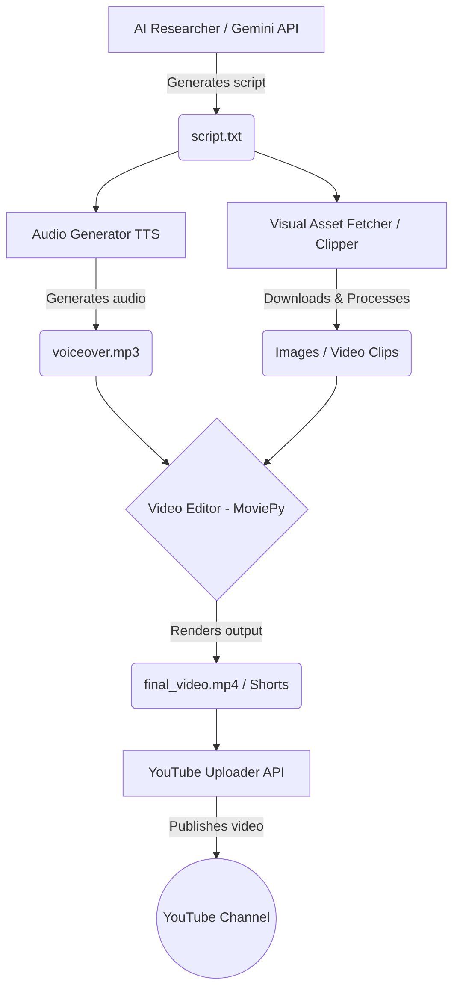

# 🤖 YouTube Automation AI Agent

An end-to-end autonomous AI system that creates, edits, and uploads YouTube videos and viral YouTube Shorts automatically using Google Gemini AI, MoviePy, and the YouTube Data API.

---

## 🏗️ YouTube Automation Blueprint

The core architecture is built as an extensible, modular pipeline so that research, voiceover, video rendering, and uploading operate as independent stages.

### 📐 System Architecture



### 🧩 Pipeline Modules

1. **Research & Scripting Module (`modules/researcher.py`)**: Uses Google Gemini AI (`google-genai`) to generate engaging YouTube scripts, titles, and SEO-optimized descriptions based on trending topics.
2. **Audio Generation Module (`modules/audio_gen.py`)**: Converts generated scripts into crystal-clear voiceovers using `edge-tts`.
3. **Video Rendering Module (`modules/video_gen.py`)**: Assembles audio, backgrounds, and styled text overlays into vertical or widescreen formats with `moviepy` and `Pillow`.
4. **Viral Clipper Module (`modules/clipper.py`)**: 
   - Dynamically searches trending livestreams from top gaming channels.
   - Fetches Hindi/English transcripts.
   - Prompts Gemini AI to detect the most intense/viral 45–60s segment.
   - Downloads only the selected clip slice directly using `yt-dlp --download-sections`.
   - Crops to 9:16 vertical ratio, adds credit overlays, and triggers automated uploads.
5. **YouTube Upload Module (`modules/youtube_upload.py`)**: Authenticates via OAuth 2.0 (`google-api-python-client`) and uploads the finalized video with tags, title, and description directly to your channel.

---

## 🛠️ Tech Stack & Prerequisites

- **Python 3.10+**
- **Google Gemini API Key** (Free from [Google AI Studio](https://aistudio.google.com/))
- **Google Cloud Console Project** with YouTube Data API v3 enabled (OAuth Client ID)
- **FFmpeg** (installed on system path or via `imageio-ffmpeg`)
- **Key Libraries**: `google-genai`, `google-api-python-client`, `google-auth-oauthlib`, `moviepy`, `edge-tts`, `yt-dlp`, `youtube-transcript-api`, `Pillow`, `python-dotenv`

---

## 🚀 Setup & Installation Guide

Follow these step-by-step instructions to set up the project locally.

### 1. Clone the Repository
```bash
git clone https://github.com/panuu18/youtube-automation-AI-Agent.git
cd youtube-automation-AI-Agent
```

### 2. Set Up a Virtual Environment
```bash
# Windows
python -m venv venv
.\venv\Scripts\activate

# Linux / macOS
python3 -m venv venv
source venv/bin/activate
```

### 3. Install Dependencies
```bash
pip install -r requirements.txt
```

### 4. Configure Environment Variables
Create a `.env` file in the root directory:
```env
GEMINI_API_KEY=your_gemini_api_key_here
```

### 5. Setup YouTube OAuth Credentials
1. Go to the [Google Cloud Console](https://console.cloud.google.com/).
2. Create a project and enable the **YouTube Data API v3**.
3. Go to **APIs & Services > Credentials** and create an **OAuth 2.0 Client ID** (Desktop Application).
4. Download the JSON credential file, rename it to `client_secret.json`, and place it in the project root.
5. Run the authentication script to generate your OAuth token:
   ```bash
   python -c "from modules.youtube_upload import get_authenticated_service; get_authenticated_service()"
   ```
   A browser window will open asking you to log into your Google account and grant upload permissions. This creates `token.pickle`.

---

## 🏃 Running the Automation

### Option A: Run Full Content Creation Pipeline
Generates an AI script from scratch, synthesizes audio, renders a video, and uploads it:
```bash
python main.py
```

### Option B: Run the Viral Clipper Bot
Finds trending livestreams, extracts the most viral 60 seconds with Gemini AI, edits into a 9:16 Short, and uploads:
```bash
python modules/clipper.py
```

### Option C: 1-Click Runner (Windows)
Double-click `RunBot.bat` to run the clipper bot instantly with a single click.

---

## ⏰ Automated Daily Scheduling (Windows Task Scheduler)

To run the bot automatically every day (e.g., at peak upload times like **1:55 PM** and **6:55 PM** IST):

1. Press `Win + S`, search for **Task Scheduler**, and open it.
2. Click **Create Basic Task...** in the right-hand panel.
3. Enter Name: `YouTube Bot 2PM` and click **Next**.
4. Set Trigger to **Daily** and set the time to **1:55 PM**.
5. Set Action to **Start a program**.
6. Click **Browse...** and select `RunBot.bat` located inside your project folder.
7. Click **Finish**.
8. Repeat the same steps for a second task `YouTube Bot 7PM` set to **6:55 PM**.

> 💡 **Note on Cloud Execution**: Cloud providers (AWS, GCP, Azure, GitHub Actions) often encounter HTTP 429 / IP bans from YouTube when fetching transcripts or downloading videos. Running locally on a residential IP connection ensures 100% reliable execution without IP blocks.

---

## 📁 Repository Structure

```text
├── assets/                  # Media files, overlays, and generated outputs
├── modules/
│   ├── audio_gen.py         # Text-to-speech audio synthesis (edge-tts)
│   ├── clipper.py           # Viral livestream detection, AI clipping & Short creation
│   ├── researcher.py        # Gemini AI script & metadata generation
│   ├── video_gen.py         # Video composition & rendering (MoviePy)
│   └── youtube_upload.py    # YouTube Data API v3 uploader
├── main.py                  # Full pipeline orchestrator
├── RunBot.bat               # 1-Click execution script for Windows
├── requirements.txt         # Project Python dependencies
└── README.md                # Project documentation & blueprint
```

---

## 📜 License & Attribution

This project is licensed under the MIT License. Built with ❤️ using Google Gemini AI, MoviePy, and YouTube Data API.
